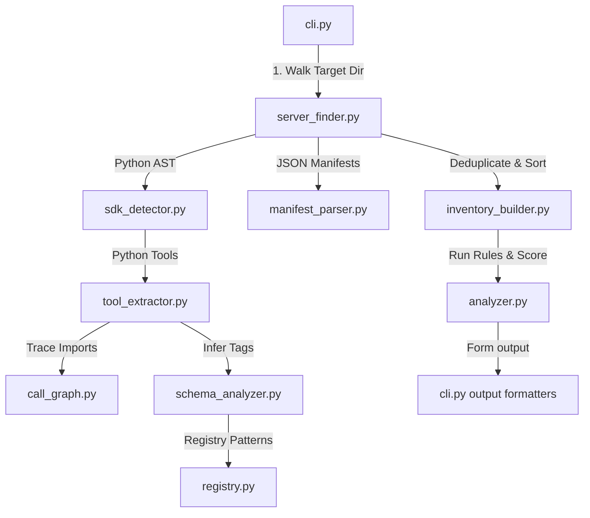

# AgentShield Architecture & Design Principles

This document outlines the core architectural decisions, design constraints, and technical trade-offs of **AgentShield**.

---

## 1. Core Architectural Pillars

### 🔒 Static-Only Analysis
AgentShield is designed to inspect MCP servers without executing their code. It uses **Abstract Syntax Tree (AST) parsing** for Python source files, and lightweight regex-based token parsing for Node.js files.
- **Why?** Scanned code may be malicious or untrusted. Running live penetration tests or importing code onto a scanning agent is a severe security risk.
- **Privacy & Zero API Keys:** The scan executes completely locally, requiring no network connection or third-party APIs (like VirusTotal or LLMs-as-a-judge).

### 🔍 Transparent Boundary Model (The "Unknown" State)
A static analysis tool cannot reason about all possible code paths. When a tool has no matched capabilities but calls unrecognized external libraries, AgentShield marks it as **`Unknown capability (manual review recommended)`**.
- **The Philosophy:** Falsely reporting a tool as "Clean" just because it uses an unrecognized package is unsafe. Honest reporting of limits builds trust.

### 🛡️ Capability-Based Reasoning (`combined_risk`)
Rather than relying purely on simple pattern matching, AgentShield assigns capability tags (`filesystem`, `network`, `database`, `execution`) to each tool and reasons about their combined presence at the server boundary.
- **The Philosophy:** Exposing database access and network outbound requests within the same server represents an automatic data exfiltration path, even if the individual tools appear safe. Calculating server-level risk based on tool capability intersections is a core strength.

---

## 2. Scanning Pipeline Flow

1. **Discovery:** Walks the directory tree to identify server files (FastMCP Python files, `@modelcontextprotocol/sdk` JS/TS files, `mcp.json`, `package.json`).
2. **Extraction:** Python files are AST-parsed to discover decorated tools, their parameter schemas, and call graphs.
3. **Inference:** Maps tool actions and parameters against the centralized registry (`registry.py`) to assign capabilities.
4. **Scoring & Rules:** Runs rule checks (e.g. LLM execution taint, secrets, transport configurations) and generates findings.
5. **Deduplication:** Deduplicates findings by context and location before calculating the security score (0-100).
